# GitPanel

本地、离线、轻量的 Git 可视化管理面板。分支树 / 历史提交 / 并排 Diff / 主题切换 / 命令面板 / 插件命令，一次到位。

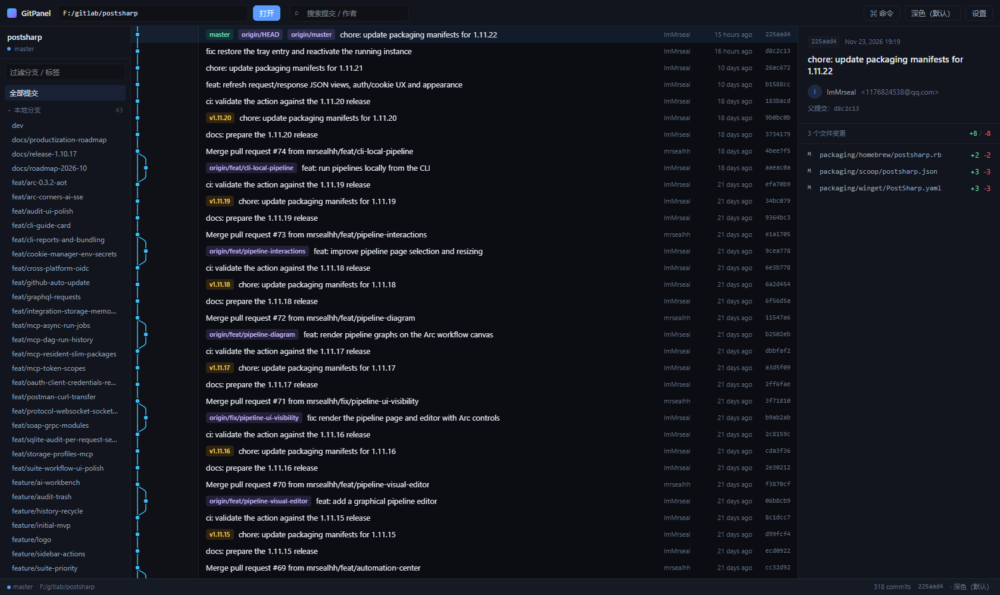

| 浅色主题 | 设置面板 |
|---|---|
| 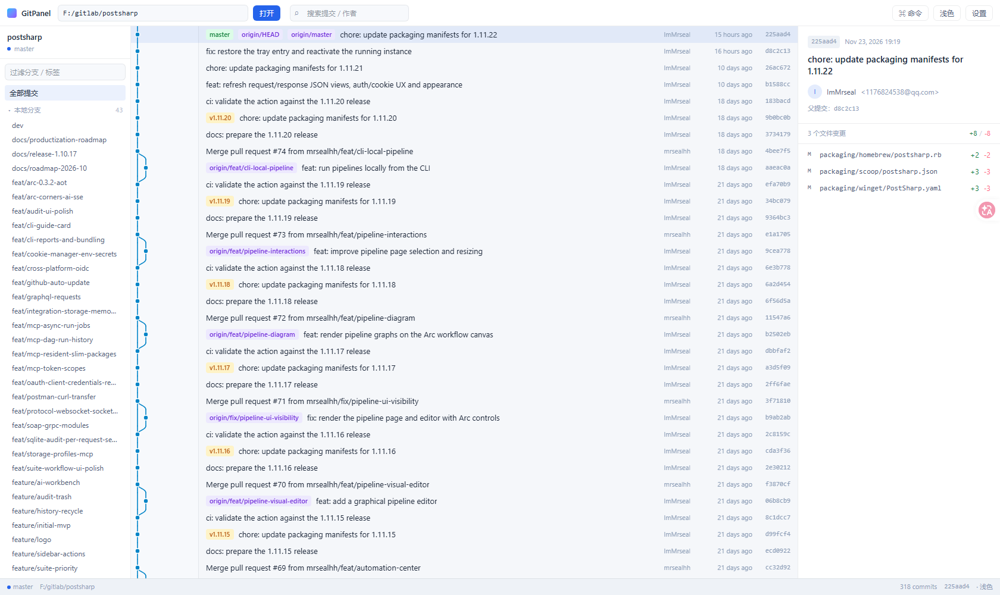 | 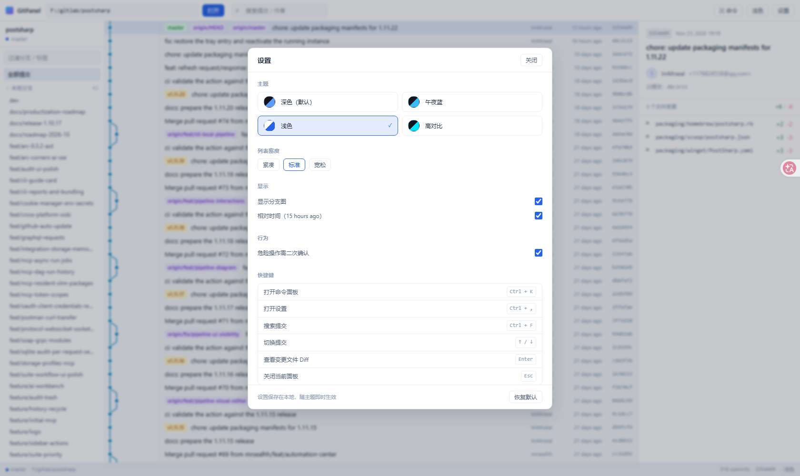 |

| 命令面板（含插件） | 并排 Diff |
|---|---|
| 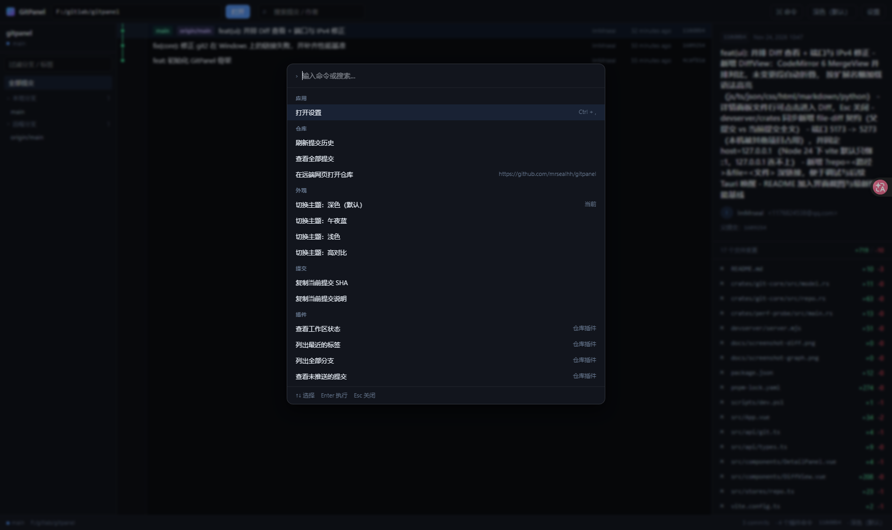 | 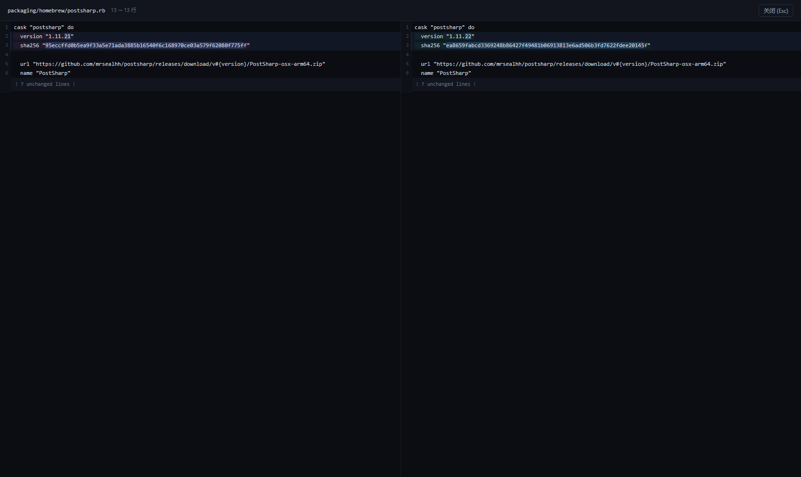 |

| 工作区（暂存 / 提交） | 冲突解决 |
|---|---|
| 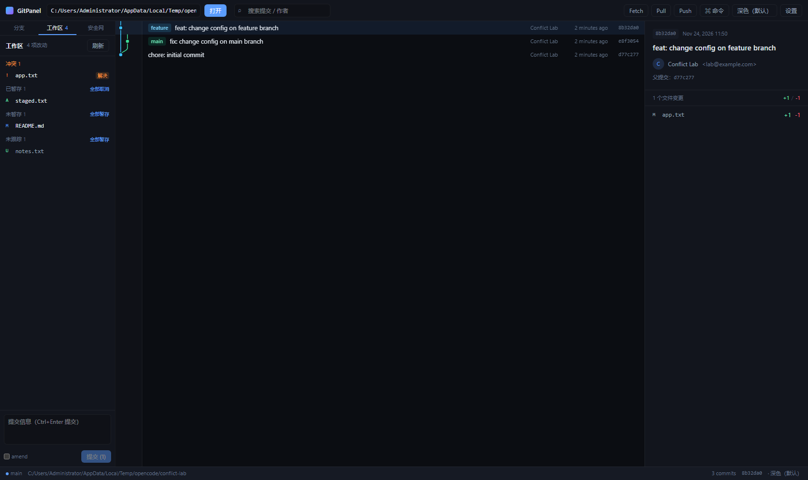 | 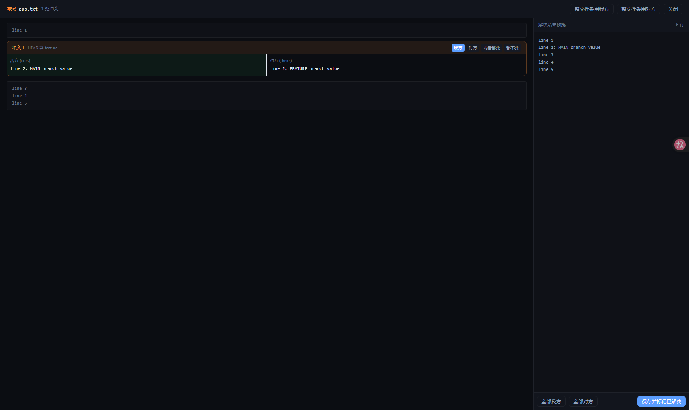 |

| 交互式 rebase | 工作树（AI 并行副本） |
|---|---|
| 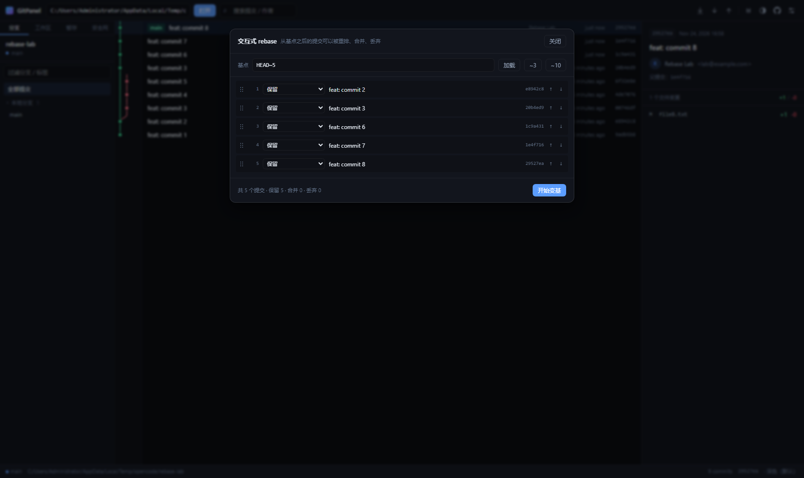 | 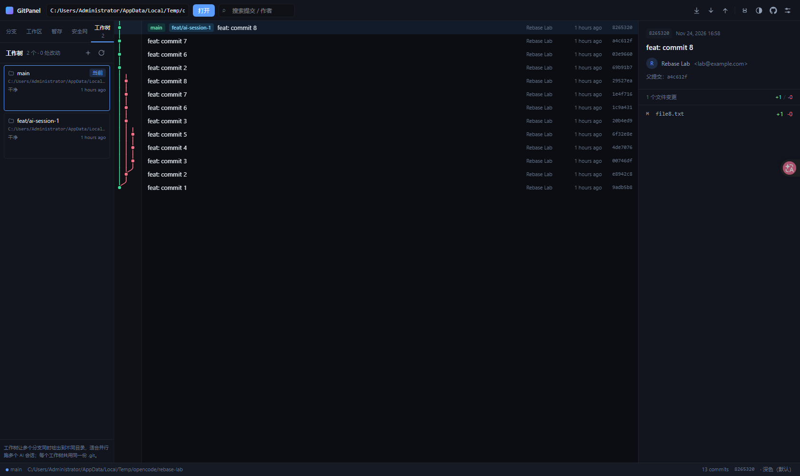 |

| 仓库体检 |
|---|
| 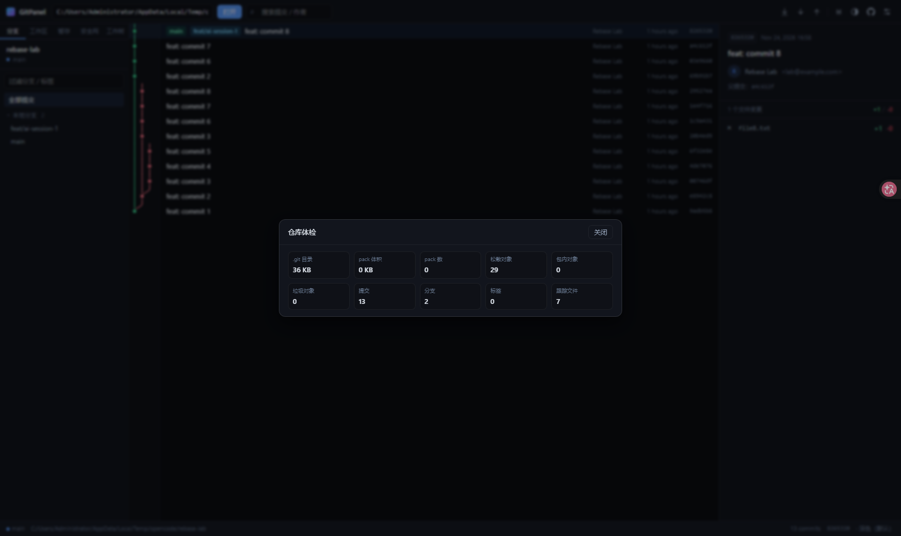 |

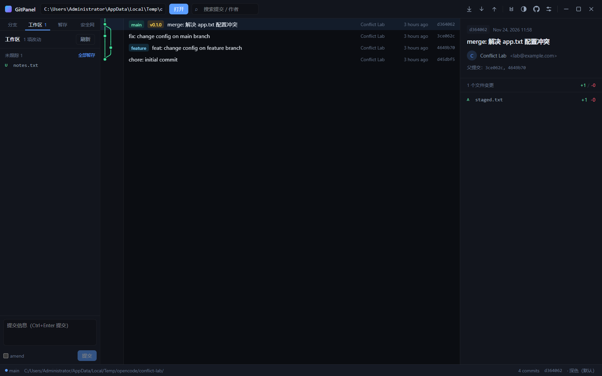

## 功能

**浏览**
- 分支树：泳道布局算法，颜色绑定分支名（跨页不变色），合并/分叉曲线，Canvas 只画可视区
- 虚拟滚动：DOM 节点恒定，10 万提交仍 60fps
- ref 徽章：当前分支 / 本地 / 远程 / 标签，四种配色随主题切换
- 提交搜索：按说明、作者、短 SHA、分支名即时过滤
- 键盘导航：`↑` `↓` 切换提交，`Enter` 直接打开变更文件
- 提交右键菜单：复制 SHA / 说明、查看变更、在远端打开、在此提交上新建分支、只看此提交起的历史

**查看**
- 并排 Diff（CodeMirror 6 MergeView），未变更段落自动折叠
- 按扩展名懒加载语法高亮：js / ts / jsx / tsx / json / css / html / vue / markdown / python
- 二进制文件与超大文件（>400KB）给明确提示，不卡界面
- 提交详情：作者、时间、父提交、文件级 +/- 统计

**产品化**
- 4 套主题：深色 / 午夜蓝 / 浅色 / 高对比，CSS 变量驱动，即时生效并持久化
- 设置面板：主题、列表密度（紧凑/标准/宽松）、显示分支图、相对时间、危险操作确认、快捷键速查
- 命令面板 `Ctrl+K`：模糊搜索所有操作、主题、插件命令
- 插件命令：仓库级 / 用户级 `commands.json`，在面板里执行并展示 stdout/stderr 与退出码
- 状态栏：当前分支、仓库路径、提交数、插件数、选中 SHA、当前主题
- **无边框自绘标题栏**：可拖拽、双击最大化、8 方向缩放，窗口按钮跟随主题
- **系统托盘**：最小化/关闭可收进托盘，托盘菜单可恢复或退出
- **多项目记忆**：SQLite 记录最近打开的仓库，支持置顶与移除
- **更新检查**：启动自动检查 GitHub Releases，顶部提示新版本并跳转下载
- 图标化按钮：常用操作全部用图标 + 悬停提示，节省横向空间

**干活**
- 工作区三态：已暂存 / 未暂存 / 未跟踪，可单文件或批量暂存、取消暂存、丢弃，点文件直接看工作区 Diff
- 提交：多段提交信息（空行分段）、`amend`、`Ctrl+Enter` 提交；提交后自动定位到新提交
- 同步：Fetch / Pull / Push（带 ahead·behind 计数），Pull 前自动打快照
- **安全网**：丢弃、拉取、回滚前自动创建 `refs/gitpanel/snapshots/<ts>-<op>`，面板里一键回滚；回滚前会再留一份，避免二次误操作
- **冲突解决**：块级取舍（我方 / 对方 / 两者都要 / 都不要），左右对照 + 实时结果预览，也可以整文件采用某一侧；保存即 `git add`
- **暂存（stash）**：新建、应用、弹出、删除，可查看补丁全文
- **标签**：轻量 / 附注标签创建，删除，按时间排序
- **分支操作**：检出、合并到当前、重命名、删除（右键菜单）
- **撤销**：reflog 时间线，支持 soft / mixed / hard 重置到任意历史点
- **交互式 rebase**：拖拽重排提交，逐条设置保留 / 合并(squash) / 合并丢说明(fixup) / 丢弃 / 暂停编辑；
  变基遇到冲突或 edit 暂停时工作区顶部出现状态条（显示当前提交），解决后继续 / 跳过 / 中止
- **工作树（worktree）**：一处查看所有并行工作副本——分支、脏文件数、ahead/behind、最近活动、
  是否带 AI 配置（AGENTS.md / CLAUDE.md / .cursor）；一键新建（自动拉分支）、打开、复制路径、移除、清理失效项
- **文件历史**：单文件提交历史（`--follow` 跟随重命名），点任意一条直接看该提交里这个文件的并排 Diff
- **Blame**：逐行归属，相邻同一提交共用底色，悬停看作者与时间
- **仓库体检**：`.git`/pack 体积、松散对象、垃圾对象、提交/分支/标签/文件数、历史最大对象与优化建议

## 技术栈

| 层 | 技术 |
|---|---|
| 桌面壳 | Tauri 2（WebView2，安装包 ~10MB） |
| Git 内核 | Rust：`crates/git-core`（读路径 libgit2，写路径 git CLI） |
| 前端 | Vue 3 + Vite + TypeScript + Tailwind CSS |
| 提交图 | Canvas 2D 自绘（只画可视区） |
| Diff | CodeMirror 6 + `@codemirror/merge` |

## 目录

```
crates/git-core       仓库/遍历/泳道布局/提交详情/文件对比/动作（检出、建分支、插件命令）
crates/perf-probe     性能基准 CLI（含 --synth 纯算法模式）
devserver/            开发期数据桥：直调本机 git，输出与 Rust 内核一致的契约
src/api/              数据适配层（前端唯一数据入口）
src/stores/           repo（数据）、settings（主题与偏好）
src/components/       提交图、列表、详情、Diff、设置、命令面板、右键菜单、状态栏
scripts/              开发脚本（启动、清理 target、CDP 截图）
.gitpanel/            插件命令示例配置
```

## 快速开始

### 桌面版（推荐）

```powershell
pnpm install
pnpm desktop:dev      # 开发模式（自动起 vite + Tauri 窗口）
pnpm desktop:build    # 打包安装包（NSIS）
pnpm desktop:exe      # 只出 exe，不打包安装包
```

桌面态的数据来自 Rust 内核（`git_call` 单一 RPC 入口），**不需要** 起 devserver。

### 前端 + 开发数据桥（不需要 Rust）

```powershell
pnpm install
pnpm dev:all          # 数据桥 7717 + 前端 5273
```

打开 http://127.0.0.1:5273 ，顶部填任意本机仓库路径即可。

> 端口说明：5173 是 vite 默认端口，本机常被其他项目占用，这里固定 5273；并把 host 固定为 `127.0.0.1`（Node 24 下 vite 默认只绑 `::1`）。
>
> 深链接：`?repo=<路径>&file=<文件>&theme=<dark|midnight|light|contrast>`，便于调试与以后 Tauri 唤醒。

### Rust 内核

```powershell
cargo test -p git-core          # 布局 + 安全校验单测
cargo run -p perf-probe -- F:\gitlab\gitpanel 5000
cargo run -p perf-probe -- --synth 100000
```

编译产物输出到 `C:\cargo-target\gitpanel`（见 `.cargo/config.toml`），避免机械盘随机小文件读写瓶颈。

## 桌面打包

`src-tauri/` 是 Tauri 2 外壳，前后端通过**单一 RPC 入口**通信：

```
前端 api.post('/api/graph', payload)
  ├─ 浏览器态 → HTTP  → devserver (node)
  └─ 桌面态   → invoke('git_call', { cmd: 'graph', payload }) → Rust git-core
```

`cmd` 与 `/api/<cmd>` 同名、`payload` 同构，所以 **UI 代码零分支**，两种运行方式共用一份前端。

```powershell
pnpm desktop:dev      # 开发：vite + Tauri 窗口（数据走 Rust）
pnpm desktop:exe      # 只出 exe
pnpm desktop:build    # 出 NSIS 安装包
```

产物：`C:\cargo-target\gitpanel\release\gitpanel.exe`（编译产物重定向到 SSD），安装包在
`release\bundle\nsis\GitPanel_0.1.0_x64-setup.exe`。

命令行打开仓库：

```powershell
gitpanel.exe D:\code\my-repo
```

最近打开记录存在 `%APPDATA%\com.gitpanel.desktop\gitpanel.db`（SQLite）。

## 自动更新与发版

桌面版内置 Tauri updater，更新包用 **minisign 签名**校验，只接受本仓库发布且签名匹配的安装包。

**本地密钥（已生成，`.keys/` 已 gitignore）**

| 文件 | 用途 |
|---|---|
| `.keys/gitpanel.key` | 私钥，用来签名更新包。**务必自行备份，丢了就无法再发更新** |
| `.keys/gitpanel.key.pub` | 公钥，已内嵌到 `tauri.conf.json` 的 `plugins.updater.pubkey` |
| `.keys/password.txt` | 私钥口令 |

**在 GitHub 配两个 Secrets**（Settings → Secrets and variables → Actions）

| Name | Value |
|---|---|
| `TAURI_SIGNING_PRIVATE_KEY` | `.keys/gitpanel.key` 文件全文 |
| `TAURI_SIGNING_PRIVATE_KEY_PASSWORD` | `.keys/password.txt` 的内容 |

**发版**

```powershell
git tag v0.1.1
git push origin v0.1.1
```

`.github/workflows/release.yml` 会在 windows-latest 上构建、签名、创建 Release，并生成
`latest.json`（`src-tauri/tauri.release.conf.json` 打开 `createUpdaterArtifacts`，本地构建不受影响）。

**更新行为**（设置 → 更新）

- 启动时自动检查：默认开启
- 自动下载安装（静默更新）：开启后检查到新版会在后台下载、安装并自动重启
- 未开启时顶部出现 `↑ 更新 vX.Y.Z`，点一下即下载安装

更新源：`https://github.com/mrsealhh/gitpanel/releases/latest/download/latest.json`

> 自动更新只对**通过安装包安装**的版本生效（NSIS 安装后由插件替换安装目录里的程序）。
> 直接拷走的便携 exe 不参与自动替换。

## 快捷键

| 快捷键 | 作用 |
|---|---|
| `Ctrl + K` | 命令面板 |
| `Ctrl + ,` | 设置 |
| `Ctrl + F` | 聚焦搜索 |
| `↑` / `↓` | 切换提交 |
| `Enter` | 打开变更文件 Diff |
| `Esc` | 关闭当前浮层 / 清空搜索 |

## 插件命令

在仓库根目录建 `.gitpanel/commands.json`（仓库级），或 `%USERPROFILE%\.gitpanel\commands.json`（用户级，全局可用）。同 id 时仓库级优先。

```json
[
  {
    "id": "git-status",
    "title": "查看工作区状态",
    "description": "git status --short --branch",
    "command": "git",
    "args": ["status", "--short", "--branch"]
  },
  {
    "id": "custom-shell",
    "title": "自定义 shell 命令",
    "command": "echo hello && git rev-parse --short HEAD",
    "shell": true
  }
]
```

- 默认以数组形式传参（不经 shell），`"shell": true` 时整条命令交给系统 shell 执行
- 执行结果在面板里展示，含退出码、耗时、stdout/stderr，可一键复制
- 命令在仓库根目录执行，超时 60 秒，输出上限 8MB
- 只在命令面板里显式触发，不会自动运行

## 数据契约

前端只认 `src/api/types.ts`，与 `crates/git-core/src/model.rs` 一一对应。
浏览器态走 `devserver/` 的 HTTP 桥，Tauri 态换成 `invoke()`，**界面代码零改动**。

## 性能基线（i5-13400 / 32G，项目在机械盘、target 在 SSD）

真实仓库 `postsharp`（318 提交 / 156 refs）：

| 操作 | 首次（冷） | 热 |
|---|---|---|
| 打开仓库 | 11 ms | 11 ms |
| 读取 refs | 39 ms | 23 ms |
| 提交遍历 + 泳道布局 | 73 ms | 35 ms |
| 提交详情（含 diff 统计） | 250 ms | 19 ms |
| 单文件全文对比 | — | 0.27 ms |

纯布局算法（合成 10 万提交，不碰磁盘）：

```
layout synth : 188–283 ms   100000 rows, 223531 segments
```

前端产物：`406 KB JS + 23 KB CSS`（gzip 139 KB + 6 KB），语言包按需异步加载。

## 当前进度

- [x] 仓库打开 / 分支标签 / 最近仓库
- [x] 提交图（泳道布局 + Canvas + 虚拟滚动）
- [x] 提交列表 / 详情 / 文件变更统计
- [x] Rust 内核 + 单测 + 性能基准 CLI
- [x] 并排 Diff（折叠未变更、语法高亮懒加载）
- [x] 主题系统（4 套）、设置面板、状态栏
- [x] 命令面板、快捷键、提交搜索、右键菜单
- [x] 插件命令（仓库级 / 用户级）
- [x] 检出分支、创建分支（含引用名白名单校验）
- [x] 工作区（暂存 / 取消暂存 / 丢弃 / 工作区 Diff）
- [x] 提交（多段信息 / amend）、Fetch / Pull / Push
- [x] 安全网快照（自动创建 + 一键回滚）
- [x] 冲突解决（块级取舍 + 结果预览 + 整文件采用）
- [x] 暂存 stash（新建 / 应用 / 弹出 / 删除 / 查看补丁）
- [x] 标签（创建轻量 / 附注、删除）
- [x] 分支操作（检出 / 合并 / 重命名 / 删除）
- [x] reflog 撤销（soft / mixed / hard）
- [x] Tauri 2 桌面壳（无边框标题栏 / 缩放 / 托盘 / 安装包 2.6MB）
- [x] 多项目记忆（SQLite）+ 更新检查 + 图标化工具条
- [x] 一键/静默更新（minisign 签名 + GitHub Releases 自动发版）
- [x] 交互式 rebase（拖拽重排 / squash / fixup / drop + 冲突与 edit 暂停续做）
- [x] 工作树管理（并行副本一览 / 新建 / 移除 / 清理）
- [x] 文件历史 / Blame / 仓库体检
- [ ] 交互式 rebase 的「暂停编辑」后一键 amend 提交
- [ ] 工作树与 AI 会话的关联（记录每个副本对应哪个 agent）

## 内核一致性

| 能力 | devserver（当前运行） | Rust 内核 |
|---|---|---|
| 历史 / 布局 / 详情 / 文件对比 | ✅ | ✅ |
| 工作区状态 / 暂存 / 提交 / 快照 | ✅ | ✅ |
| 冲突解析与合成 | ✅ | ✅ |
| stash / tag / reflog | ✅ | ⏳ 待同步 |

写操作两侧都走 git CLI，读路径两侧都是结构化解剖，契约一致。

## 设计文档

`C:\Users\Administrator\Desktop\AICoding\autofix\Git可视化管理面板-技术选型与架构设计.md`
