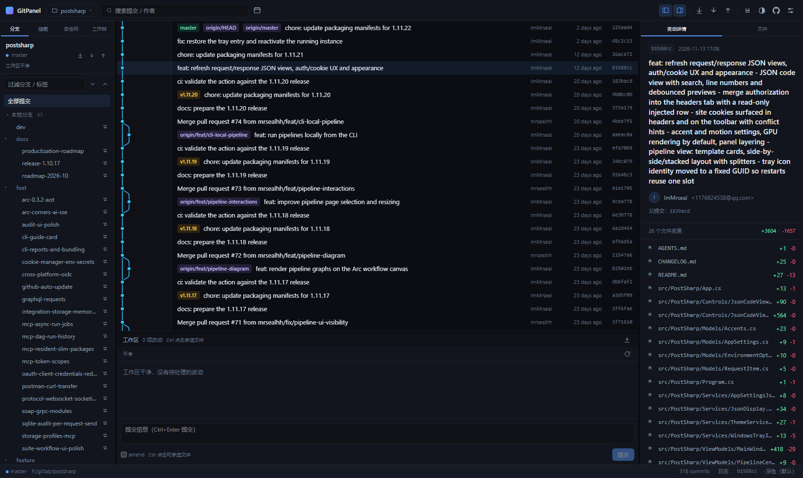
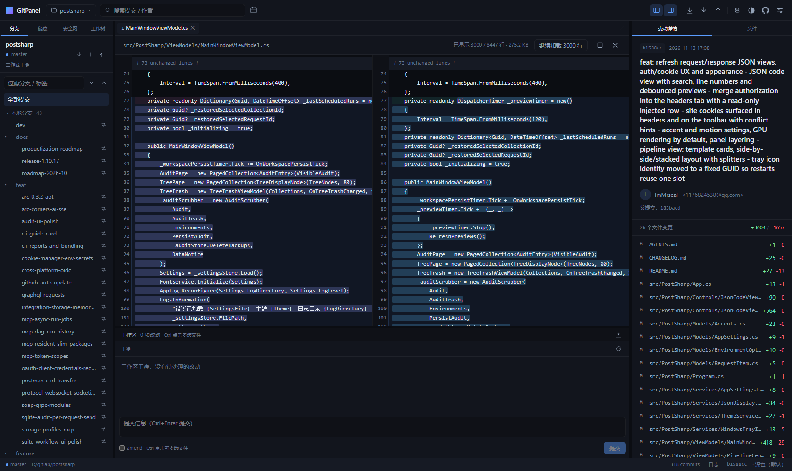
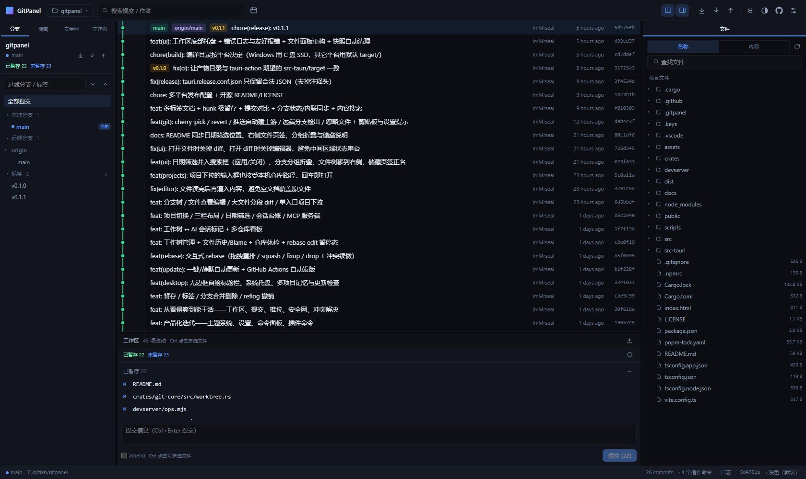
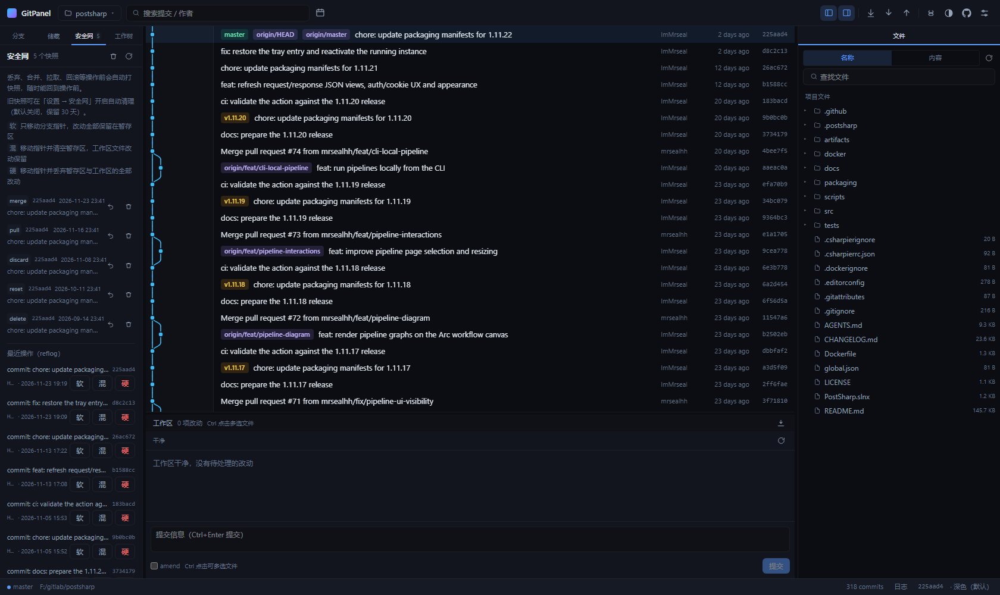
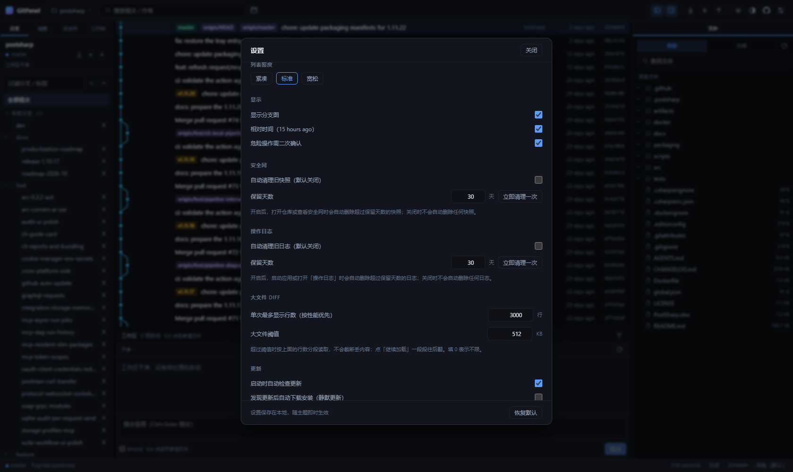
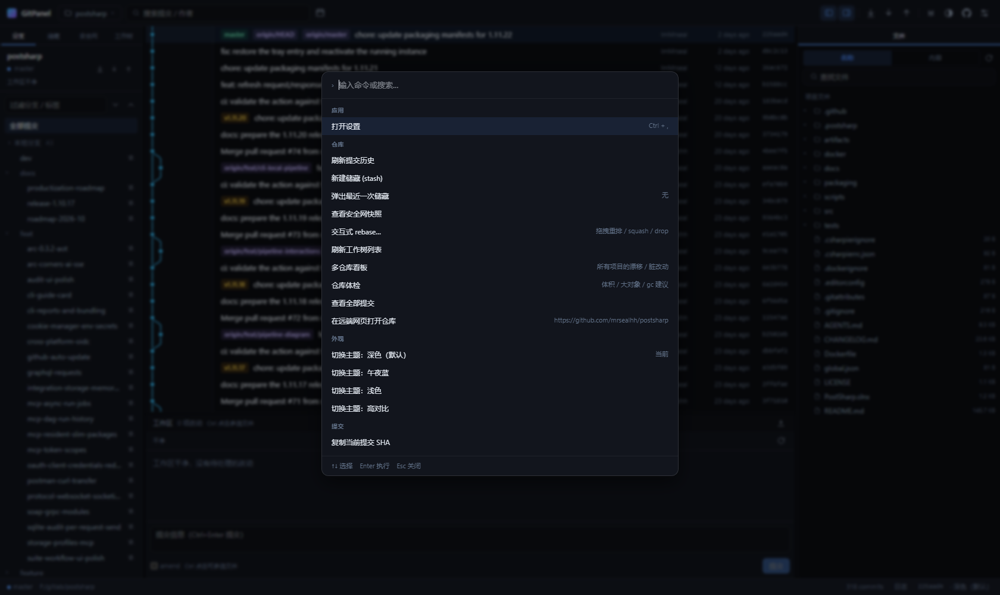
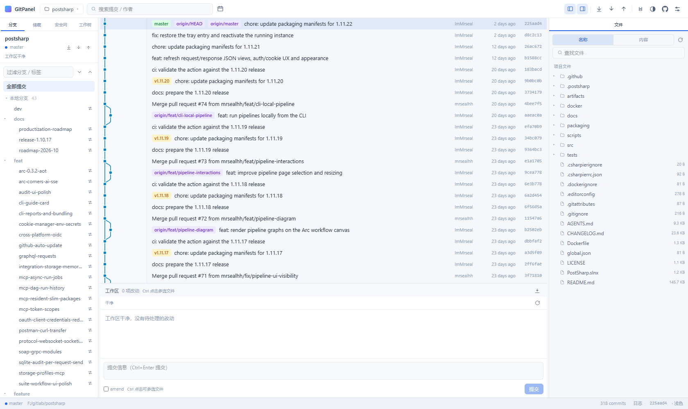

# GitPanel

本地优先的 Git 图形客户端：分支树、提交图、并排 Diff、交互式 rebase、工作树、按块暂存，
外加一个把仓库能力开放给 AI 的 MCP 服务端。

纯本地运行，不联网、不上传代码、不保存任何凭据。

[](https://github.com/mrsealhh/gitpanel/releases)
[](LICENSE)
[](#install)

<p align="center">
  
</p>

## 界面预览

截图来自真实仓库，不是设计稿。

| 并排 Diff（大文件分段加载） | 工作区与按块暂存 |
| --- | --- |
|  |  |

| 安全网快照与 reflog | 设置：安全网自动清理 |
| --- | --- |
|  |  |

<details>
<summary>更多截图：命令面板 / 浅色主题</summary>

| 命令面板 | 浅色主题 |
| --- | --- |
|  |  |

</details>

## 功能

**历史与浏览**
- Canvas 自绘提交图：泳道布局、分页加载、相对时间
- 搜索提交（说明 / 作者 / SHA）+ 日期范围筛选（今日 / 昨日 / 近三天 / 近一周，或自定义起止）
- 「只看某分支 / 某提交起的历史」，顶部常驻返回栏
- 任选两个提交 / 分支对比：文件列表 + 并排 Diff
- 提交详情按需打开：点某行提交才出现「变动详情」页签，可随时关闭，默认只留「文件」页签
- 内容级历史搜索（`git log -S`）：查某段代码 / 文案是在哪个提交加入或删除的
- 提交详情、文件历史（跟随重命名）、Blame、仓库体检、reflog

**改动与提交**
- 工作区三态（已暂存 / 未暂存 / 未跟踪）+ 冲突文件一眼可见
- **按 diff 块暂存 / 取消暂存 / 丢弃**，也可以整文件操作
- 多段提交信息、amend、`Ctrl+Enter` 提交
- 并排 Diff（CodeMirror 6 MergeView），未变更段落自动折叠，左右滚动同步
- 大文件 Diff 滚动到底部自动续读下一段，也可以手动「继续加载」

**分支与协作**
- 分支按 `/` 分层成树，本地 / 远端 / 标签分组可折叠
- 远端仓库管理：新增 remote、修改地址、删除本地 remote 配置
- 每个分支显示上游 ahead / behind；当前分支下方常驻抓取 / 拉取 / 推送
- Pull 策略可配：merge / rebase / ff-only，自动 autostash
- 检出 `origin/xxx` 自动建同名本地跟踪分支；远端分支也可直接签出或删除
- 分支右键：合并、交互式 rebase、重命名、删除（可一并删除远端分支）
- 推送时自动 `--set-upstream`，不再被 "no upstream branch" 卡住
- Cherry-pick / Revert，冲突后「继续 / 跳过 / 中止」

**改写历史**
- 交互式 rebase：pick / reword / edit / squash / fixup / drop，支持冲突与编辑暂停
- reset soft / mixed / hard，reflog 一键回滚
- **安全网**：合并、拉取、重置、丢弃前自动打快照，可回滚，也可彻底删除；默认不自动清理，可在设置里开启「删除超过 N 天（默认 30 天）的快照」
- **操作日志**：错误与关键操作可复盘；日志同样支持配置保留天数，默认不自动删除

**工作树与多仓库**
- 工作树（并行副本）增删、prune
- 每个副本可记录「由谁使用」「在做什么」（prompt / issue 链接），并标注是否已合回主干
- 多仓库看板：一次看所有仓库的分支、漂移、脏改动、最后活动

**文件**
- 右侧「文件」页签：目录树、按名称搜索、**按内容搜索**（结果按目录树分组）
- 直接在应用内查看 / 编辑文件，`Ctrl+F` 文件内搜索，`Ctrl+S` 保存
- 大文件预览按 512KB 分段流式加载，滚动到底部自动续读，首屏不用等整文件
- 文件树 / 文件页签右键可复制相对路径、绝对路径、所在目录路径，方便直接贴给 AI
- 只写 UTF-8（保留 BOM 与原换行风格）；GBK 等其它编码只读，避免写坏文件
- 编辑器与 Diff 都是**多标签**，可横向滚动、单个或全部关闭

**给 AI 用**
- `gitpanel-mcp.exe`：stdio MCP 服务端，29 个工具，读仓库 + 执行暂存 / 提交 / 分支 / 工作树 / 文件读写
- 支持只读模式：`GITPANEL_MCP_READ_ONLY=1`
- 详见 [docs/mcp.md](docs/mcp.md)

## 安装

从 [Releases](https://github.com/mrsealhh/gitpanel/releases) 下载对应平台安装包：

| 平台 | 文件 |
|---|---|
| Windows 10/11 (x64) | `GitPanel_*_x64-setup.exe`（NSIS，支持自动更新） |
| macOS (Apple Silicon / Intel) | `GitPanel_*.dmg` |
| Linux (x64) | `*.AppImage` / `*.deb` |

要求本机已安装 `git` 并加入 `PATH`。首次克隆私有仓库时，凭据由系统 Git 凭据管理器处理，
GitPanel 自身不保存账号密码。

## 开发

前置：Node 22+、pnpm 11、Rust stable、各平台 Tauri 依赖（Windows 需要 WebView2）。

```bash
pnpm install

# 前端 + 数据桥（直调本机 git）
pnpm dev:all        # vite:5173 bridge:7717

# 只跑其中一半
pnpm dev           # vite
pnpm dev:bridge    # bridge

# 桌面端（Tauri）
pnpm desktop:dev
pnpm desktop:build
```

常用检查：

```bash
pnpm typecheck
pnpm rust:test       # 等价于 cargo test -p git-core
```

> 编译产物目录：`pnpm rust:*` / `pnpm desktop:*` 会在 Windows 上默认输出到
> `C:\cargo-target\gitpanel`（可用 `CARGO_TARGET_DIR` 覆盖）；macOS / Linux
> 保持 Cargo 默认的 `target/`。直接用 `cargo` 命令时各平台也都使用默认目录。

## 架构

```
crates/git-core       Git 内核：仓库、遍历、泳道布局、提交详情、文件对比、写操作
crates/gitpanel-mcp   MCP 服务端（stdio），把 git-core 能力暴露给 AI 客户端
crates/perf-probe     性能基准 CLI
src-tauri/            桌面壳（Tauri 2）+ SQLite（最近项目 / 工作树元数据）
devserver/            开发期数据桥：直调本机 git，与 Rust 端保持同一份 JSON 契约
src/                  Vue 3 + TypeScript + Tailwind 前端
  api/                前端唯一数据入口（Tauri invoke / HTTP 二选一，组件无感知）
  stores/             仓库状态、设置、更新
  components/         提交图、列表、详情、Diff、编辑器、面板、对话框
scripts/              开发脚本（准备 MCP 产物、图标、CDP 截图）
```

读路径用 libgit2（结构清晰），写路径走 `git` CLI（与命令行行为完全一致）。
所有子进程在 Windows 上以 `CREATE_NO_WINDOW` 启动，不会闪黑框。

## 快捷键

| 快捷键 | 作用 |
|---|---|
| `Ctrl/⌘ + K` | 命令面板 |
| `Ctrl/⌘ + F` | 搜索提交；编辑器内为文件内搜索 |
| `Ctrl/⌘ + ,` | 设置 |
| `Ctrl/⌘ + S` | 保存当前文件 |
| `Ctrl/⌘ + Enter` | 提交 |
| `↑` / `↓` | 切换提交 |
| `Enter` | 打开选中提交的第一个变更文件 |
| `Esc` | 关闭当前标签 / 浮层 |

## 数据与隐私

- 最近项目、工作树备注存在本机 SQLite：`%APPDATA%\com.gitpanel.desktop\gitpanel.db`
  （macOS `~/Library/Application Support/com.gitpanel.desktop`，Linux `~/.local/share/com.gitpanel.desktop`）
- 设置存在 WebView localStorage
- 安全网快照是仓库内的 `refs/gitpanel/snapshots/*`，可随时在面板里删除
- 所有操作都在本机完成，不访问除你配置的 git 远端以外的任何网络地址

## 路线图

- [x] 按块暂存 / 丢弃（hunk staging）
- [x] 提交 / 分支之间的对比
- [x] 多标签编辑器与 Diff
- [x] 分支状态与内联推拉
- [x] 远端仓库管理（新增 / 改 URL / 删除）
- [x] Pull 策略（merge / rebase / ff-only）
- [x] 内容级历史搜索（`git log -S`）
- [ ] Submodule / Git LFS / Bisect

## 参与

欢迎提 Issue 和 PR。改动请保持与现有结构、命名和代码风格一致；
提交前跑一遍 `pnpm typecheck && pnpm rust:test`。

## 许可

[MIT](LICENSE)
